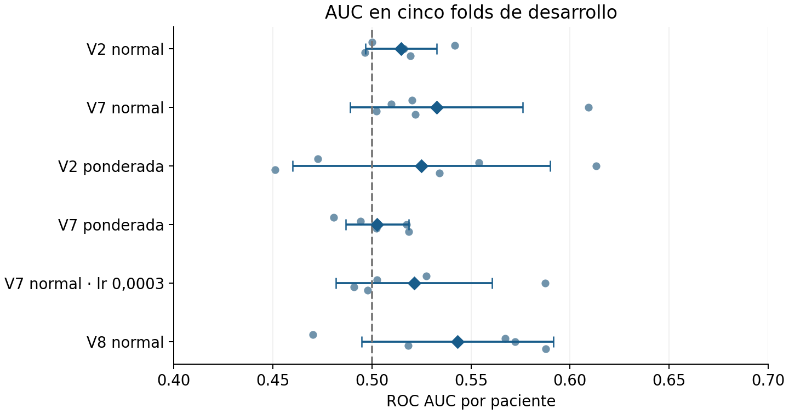
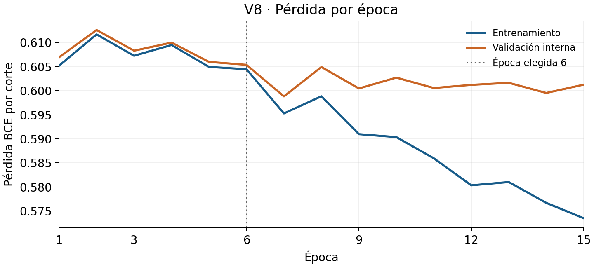
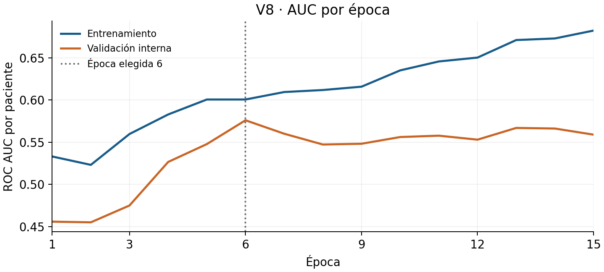
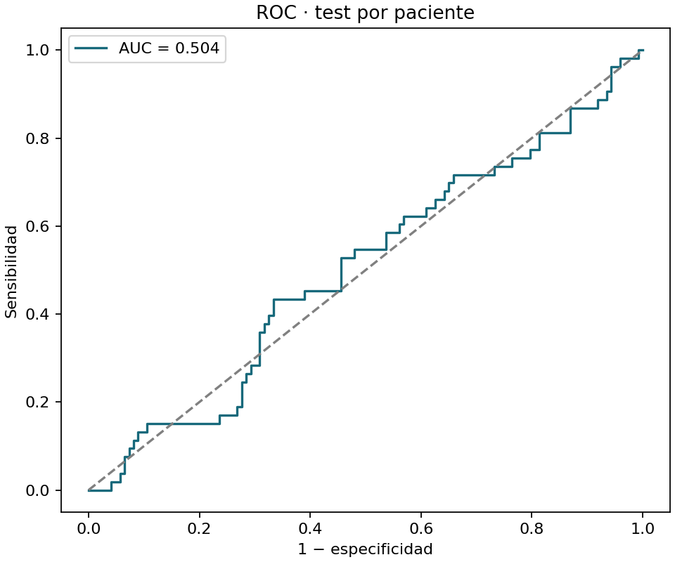
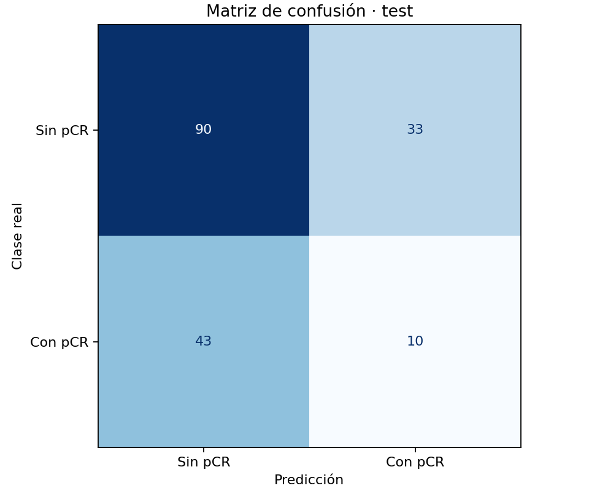
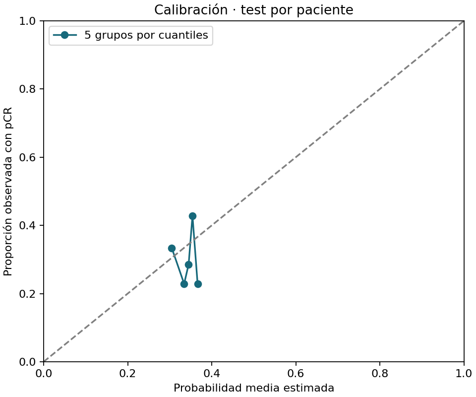
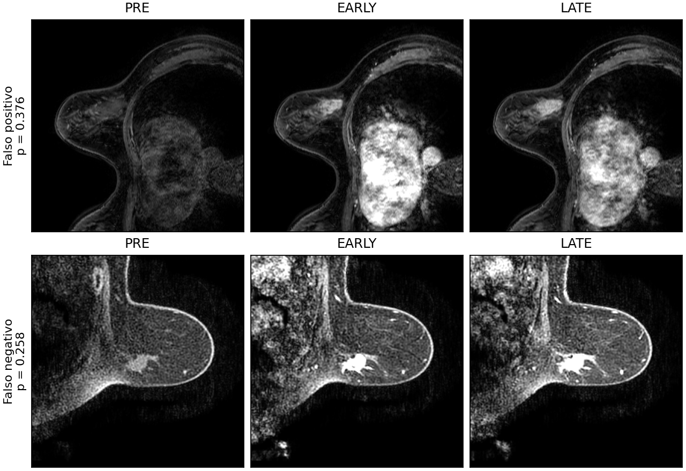

# Predicción de respuesta patológica completa mediante resonancia magnética de mama

Memoria del proyecto BreastDCEDL

Juan Hevia · Octubre de 2026

## Resumen

Se estudia la predicción de respuesta patológica completa (pCR) mediante una CNN 2D propia entrenada desde cero con las fases PRE, EARLY y LATE de resonancia magnética dinámica con contraste. La media de las probabilidades de los cortes produce una predicción por paciente. El desarrollo comprende 1.097 pacientes y 10.945 cortes, con separación estricta por paciente.

La comparación inicial de v2/v7 y pérdidas normal/ponderada obtuvo su mayor AUC externa media con v7 normal: 0,533 ± 0,044. El ensayo v8, que añade dos diferencias temporales a las fases originales, obtuvo 0,543 ± 0,048 en los mismos cinco folds. Esta pequeña diferencia no demuestra superioridad sólida. Se seleccionó v8 normal antes de consultar el test y se entrenó con 878 pacientes, reservando 219 para selección interna. Se fijaron la época 6 y el umbral 0,356243176 exclusivamente con esa validación, cuya AUC fue 0,576.

En las 176 pacientes de test, v8 obtuvo AUC 0,504, con IC del 95 % de 0,410 a 0,597; sensibilidad 18,9 %, especificidad 73,2 % y F1 macro 0,456. Detectó 10 de las 53 pacientes con pCR, con 33 falsos positivos. El resultado es compatible con ausencia de discriminación y no respalda utilidad clínica. La memoria conserva este resultado sin reajustar el modelo ni el umbral tras conocerlo.

La aplicación HTML permite inspeccionar las tres fases y obtener una estimación por paciente con los mismos pesos, normalización y agregación. La contribución del trabajo es la implementación y evaluación reproducibles, junto con un análisis explícito de sus limitaciones; no se ha logrado una predicción fiable de pCR.

**Palabras clave:** pCR, DCE-MRI, CNN, clasificación por paciente, validación cruzada.

## Contenido

1. Problema y objetivo
2. Datos y preparación
3. Diseño de la evaluación
4. Arquitecturas y entrenamiento
5. Resultados de la comparación
6. Evolución del entrenamiento
7. Umbral y verificación del modelo final
8. Aplicación web
9. Evaluación final y discusión
10. Reproducibilidad y referencias

<!-- page -->

## 1 Problema y objetivo

La respuesta patológica completa describe la ausencia de cáncer en las muestras de tejido examinadas después del tratamiento, según la definición empleada en cada estudio [4]. En este caso docente, la etiqueta distingue pCR de enfermedad invasiva residual tras el tratamiento neoadyuvante y la evaluación patológica [1]. Las imágenes utilizadas como entrada se obtienen antes del tratamiento; la etiqueta se conoce posteriormente. Por tanto, el problema consiste en estimar una respuesta futura a partir de imágenes previas, no en detectar directamente la ausencia de tumor residual.

El objetivo técnico es construir una CNN 2D propia con PyTorch, sin pesos preentrenados ni variables clínicas como entrada principal. La salida debe convertirse en una predicción única por paciente. Además de la discriminación, el trabajo estudia el desbalance de clases, la elección del umbral, el sobreajuste y la reproducción de la inferencia en una aplicación [1, 2].

Se adopta pCR = 1 como clase positiva y no pCR = 0 como negativa. Un falso positivo significa predecir pCR cuando queda enfermedad residual; un falso negativo significa predecir no pCR cuando la paciente sí alcanza pCR. La relevancia de cada error depende del uso previsto. Si una estimación positiva se interpretase erróneamente como motivo para reducir un tratamiento, el falso positivo podría resultar especialmente problemático. Este proyecto no valida ni propone esa utilización.

La predicción es una salida de investigación. No sustituye la confirmación patológica, no permite recomendar omitir una cirugía y no demuestra utilidad clínica. Tampoco debe interpretarse una puntuación de 0,60 como una frecuencia de respuesta del 60 % sin estudiar antes la calibración del sistema.

### Criterios para valorar el trabajo

Se considera prioritario mantener la separación por paciente, conservar la información temporal de las fases y justificar las decisiones con datos de desarrollo. El rendimiento se comunica mediante AUC por paciente y métricas de clasificación acompañadas de su umbral. Alcanzar una cifra prefijada, como 0,70, es una aspiración experimental y no un criterio para descartar o alterar resultados desfavorables.

El estudio compara v2 y v7 con dos pérdidas y añade dos ensayos de cinco folds: v7 con mayor tasa de aprendizaje y v8 con diferencias temporales. Las otras variantes exploratorias del repositorio no se mezclan con esta comparación. Los nombres identifican implementaciones propias, no redes preentrenadas de una biblioteca.

### Relación con BreastDCEDL

Fridman y colaboradores describen BreastDCEDL como un recurso que integra 2.070 pacientes de I-SPY1, I-SPY2 y Duke, con etiquetas pCR disponibles para un subconjunto [3]. La versión docente MinCrop transforma este recurso en cortes PNG centrados en el entorno tumoral. Las cifras de esta memoria corresponden a la edición local, no al total de pacientes del artículo. Esta distinción evita atribuir al experimento una muestra mayor que la realmente utilizada.

<!-- page -->

## 2 Datos y preparación

Los metadatos locales de desarrollo contienen 1.097 pacientes: 322 con pCR y 775 sin pCR. La prevalencia positiva es del 29,35 %. Los 10.945 cortes tienen entre cinco y diez muestras por paciente, con mediana de diez. Un corte representa una posición axial y consta de tres archivos PNG, uno por fase. Por tanto, 10.945 cortes no equivalen a 10.945 pacientes independientes.

| Cohorte de desarrollo | Pacientes | Con pCR | Sin pCR | pCR |
|---|---:|---:|---:|---:|
| Duke | 209 | 44 | 165 | 21,05 % |
| I-SPY1 | 104 | 26 | 78 | 25,00 % |
| I-SPY2 | 784 | 252 | 532 | 32,14 % |
| Total | 1.097 | 322 | 775 | 29,35 % |

Tabla 1. Recuentos calculados exclusivamente sobre las filas de desarrollo de patients.csv. I-SPY2 aporta el 71,47 % de las pacientes, de modo que las cohortes no tienen el mismo peso en el resultado global.

El enunciado reserva además 176 pacientes para test y 177 para validación privada del profesorado [1]. Esta última no es la validación interna utilizada durante el entrenamiento. Sus muestras y etiquetas no forman parte de los experimentos descritos aquí.

### Representación de las imágenes

Cada PNG tiene 256 × 256 píxeles y escala de grises de 8 bits. El lector apila las imágenes en el orden PRE, EARLY y LATE, convierte a float32 y divide entre 255. Así obtiene un tensor de tamaño 3 × 256 × 256 con valores entre cero y uno. Los canales representan momentos de adquisición, no componentes de color RGB.

Según la preparación docente, el recorte de intensidades a los percentiles 1 y 99 se realizó con una ventana común a las tres fases [1, 2]. El entrenamiento conserva esa representación: no recalcula ventanas independientes por fase, no aplica normalización de ImageNet y no modifica saturación. Alterar cada fase por separado podría cambiar las diferencias de intensidad que se desean estudiar.

Los aumentos geométricos se aplican únicamente en entrenamiento: reflejo horizontal con probabilidad 0,5 y giro aleatorio entre −10° y +10°. La misma transformación se aplica a las tres fases del corte, con interpolación bilineal y relleno cero. En validación e inferencia se utilizan los cortes originales.

### Comprobaciones realizadas

La auditoría cotejó identificadores, etiquetas, folds y rutas de todas las muestras de desarrollo usadas en la comparación. También examinó 90 PNG locales de 30 pacientes repartidas por fold y clase: se verificaron formato, tamaño y ausencia de tripletes totalmente vacíos o con las tres fases idénticas. Esta inspección es una comprobación técnica parcial; no certifica cada imagen del laboratorio ni equivale a una revisión radiológica.

El dataset emplea estrategias distintas de selección de cortes entre cohortes: máscaras tumorales en I-SPY y límites tumorales publicados en Duke [1]. Esa heterogeneidad puede introducir diferencias que la red aprenda sin que correspondan necesariamente a respuesta al tratamiento.

<!-- page -->

## 3 Diseño de la evaluación

La paciente es la unidad de separación y evaluación: todos sus cortes permanecen juntos. Dividir imágenes al azar permitiría compartir anatomía entre entrenamiento y validación y sobreestimar el rendimiento.

En cada ejecución CV, el fold k se reserva para evaluación externa de desarrollo y (k + 1) módulo 5 para selección interna. Los tres restantes entrenan los pesos. El grupo externo no interviene en el gradiente, la época o el umbral.

| Fold externo | Selección interna | Folds de entrenamiento |
|---:|---:|---|
| 0 | 1 | 2, 3 y 4 |
| 1 | 2 | 0, 3 y 4 |
| 2 | 3 | 0, 1 y 4 |
| 3 | 4 | 0, 1 y 2 |
| 4 | 0 | 1, 2 y 3 |

Tabla 2. Esquema fijo de particiones. Cada ejecución contiene 657–659 pacientes de entrenamiento, 219–220 de selección interna y 219–220 de evaluación externa de desarrollo.

La comparación inicial completó 20 ejecuciones (dos arquitecturas × dos pérdidas × cinco folds) y los dos ensayos posteriores añadieron diez. Cada paciente aparece una vez en evaluación externa por combinación; los grupos son disjuntos y excluyen el test oficial.

### Entrenamiento final con cuatro folds

Después de la comparación, v8 normal se entrenó con cuatro folds: 878 pacientes (258 pCR y 620 no pCR). El fold 0 aporta 219 pacientes para selección interna (64 pCR y 155 no pCR). No se reserva un fold externo adicional; las 176 pacientes de test siguen excluidas. La partición recibida contiene 1.097 identificadores únicos, sin solapamientos entre estos tres grupos. La AUC interna final no sustituye la estimación CV de generalización.

### Agregación y selección

Para una paciente i con nᵢ cortes, la red calcula un logit zᵢⱼ por corte. Primero se transforma mediante la sigmoide y después se promedian las probabilidades:

**pᵢ = (1 / nᵢ) · Σⱼ sigmoid(zᵢⱼ)**

La clase predicha es pCR si pᵢ ≥ t, donde t es el umbral. No se promedian logits ni decisiones binarias. Esta regla sencilla utiliza todos los cortes disponibles, pero puede diluir una señal localizada en pocos cortes. Se mantiene fija para que la comparación de arquitecturas y pérdidas sea interpretable.

La época se selecciona por la máxima AUC por paciente en selección interna. Después se fija el umbral que maximiza el F1 macro en ese mismo grupo y se calcula una única evaluación externa de la ejecución. El F1 macro es la media de los F1 de las dos clases; evita que la clase mayoritaria sea la única que determine el criterio.

### Alcance de esta validación

Se informa media y desviación estándar muestral entre folds; esta última no es un intervalo de confianza. Los entrenamientos comparten pacientes y existe exploración previa sobre desarrollo: la comparación no es una validación anidada exhaustiva de toda la búsqueda.

<!-- page -->

## 4 Arquitecturas y entrenamiento

V2 y v7 reciben el mismo tensor de tres fases y producen un único logit. Ambas se inicializan desde cero con los valores por defecto de PyTorch y una semilla fijada. No se utilizan pesos de ImageNet, aprendizaje por transferencia ni variables clínicas como entrada [5].

| Etapa | V2 | V7 | Tamaño espacial de salida |
|---|---|---|---|
| Entrada | 3 canales | 3 canales | 256 × 256 |
| Bloque 1 | 16 canales | 16 canales | 128 × 128 |
| Bloque 2 | 32 canales | 32 canales | 64 × 64 |
| Bloque 3 | 64 canales | 64 canales | 32 × 32 |
| Bloque 4 | 128 canales | 96 canales | 16 × 16 |
| Media y máximo globales | Vector de 256 | Vector de 192 | 1 × 1 por resumen |
| Clasificador | 256 → 64 → 1 | 192 → 64 → 1 | Un logit |
| Parámetros entrenables | 310.513 | 232.513 | — |

Tabla 3. Dimensiones de las arquitecturas implementadas. Cada bloque incluye una reducción espacial MaxPool de factor dos.

V2 utiliza dos convoluciones 3 × 3 por bloque, GroupNorm con ocho grupos, ReLU, MaxPool y Dropout2d 0,1. GroupNorm evita depender de estadísticas de lote pequeño. V7 añade una conexión residual con proyección 1 × 1 y GroupNorm cuando cambia el número de canales; reduce la última etapa a 96 canales. Ambas redes se implementan en el proyecto y combinan media y máximo globales. Sus clasificadores usan 64 unidades ocultas, ReLU y dropout 0,4 y 0,3. BCEWithLogitsLoss recibe logits; la sigmoide se aplica al evaluar.

### Arquitectura final v8

V8 conserva v7 y añade EARLY − PRE y LATE − EARLY a las tres fases normalizadas, tanto al entrenar como al inferir. La entrada externa sigue siendo 3 × 256 × 256; la primera convolución recibe cinco canales. Se conservan diferencias negativas sin recorte ni división adicional. Tiene 232.833 parámetros, 320 más que v7.

Los canales derivados no aportan información nueva. La hipótesis era facilitar el aprendizaje temporal con capacidad casi constante; el test no demuestra que produzca generalización útil. No se modificaron brillo, saturación ni contraste por fase.

### Pérdida normal y ponderada

La pérdida normal utiliza entropía cruzada binaria. La ponderada multiplica el término positivo por pos_weight = N₀ / N₁, calculado solo con los cortes de entrenamiento. Por ejemplo, el v7 original contiene 6.183 negativos y 2.576 positivos: peso aproximado 2,40. Ese candidato concreto empleó pérdida normal.

Aumentar el peso positivo no garantiza mayor sensibilidad al combinarlo con arquitectura y umbral seleccionados. Las magnitudes de pérdida normal y ponderada no son directamente comparables como si midieran el mismo objetivo.

<!-- page -->

### Configuración y control del entrenamiento

| Parámetro | Comparación inicial |
|---|---|
| Optimizador | AdamW |
| Tasa inicial de aprendizaje | 0,0001 |
| Weight decay | 0,001 |
| Tamaño de lote | 16 cortes |
| Semilla | 42 |
| Máximo de épocas | 40 |
| Parada anticipada | 9 épocas sin mejorar la AUC interna por paciente |
| Reducción de tasa | Factor 0,5; paciencia 3; mínimo 0,000001 |
| Selección del checkpoint | Máxima AUC interna por paciente |
| Predicción por paciente | Media de las probabilidades de sus cortes |

Tabla 4. Configuración común de las 20 ejecuciones de la comparación. El planificador ReduceLROnPlateau también observa la AUC interna.

La parada anticipada limita la continuación de un entrenamiento sin mejora en el criterio seleccionado. No significa que sea matemáticamente imposible mejorar después. El máximo de 40 épocas es un límite, no la duración obligatoria de todas las ejecuciones. La mejor época se conserva aunque el entrenamiento termine varias épocas más tarde.

Se guardan los pesos de cada época completada y, por separado, el mejor checkpoint. Los archivos .pt contienen el state_dict de la red en CPU; no son gráficos ni incluyen por sí solos la configuración completa. Para reproducir una predicción hacen falta la arquitectura, los pesos, la normalización, el orden de canales, la regla de agregación y el umbral. Tampoco constituyen una reanudación exacta del entrenamiento, porque no conservan todo el estado del optimizador.

Los historiales registran pérdida, AUC por corte y paciente, tasa de aprendizaje, tiempo y épocas sin mejora. Para comparar entrenamiento y validación en condiciones equivalentes se evalúan además los cortes originales de entrenamiento, sin aumentos y en modo eval. Esta evaluación diagnóstica no interviene en la selección del checkpoint.

### Entorno y coste computacional

La configuración del v7 original registra Linux, Python 3.12.14 y PyTorch 2.14.1+rocm7.14, con dispositivo identificado por PyTorch como cuda. En este entorno esa interfaz corresponde a ROCm. El modelo exacto de GPU no aparece en los archivos consultados y debe incorporarse desde el equipo del laboratorio.

Ese entrenamiento completó 15 épocas, con 120,8 segundos por época de media y 1.818,5 segundos totales de entrenamiento y evaluación, aproximadamente 30,3 minutos. El pico de memoria GPU registrado fue 802.428.416 bytes, aproximadamente 765,3 MiB. Estos tiempos corresponden a esa ejecución concreta y no se extrapolan a otros equipos ni a la comparación completa.

### Ensayo adicional con tasa de aprendizaje distinta

El ensayo v7 con tasa inicial 0,0003 mantuvo pérdida normal, semilla, particiones y demás parámetros. Completó los cinco folds y obtuvo AUC externa media 0,521 ± 0,039, inferior al 0,533 ± 0,044 de v7 normal a 0,0001. No se adoptó esa tasa para v8. El entrenamiento final de v8 mantuvo 0,0001 y completó 15 épocas de aproximadamente 124 segundos, unos 31 minutos sumando los tiempos registrados por época.

<!-- page -->

## 5 Resultados de la comparación

Las métricas de la tabla 5 se calcularon a nivel de paciente sobre los grupos externos de desarrollo. Sensibilidad, especificidad y F1 macro utilizan el umbral seleccionado exclusivamente en el grupo interno de cada ejecución. Las medias son medias entre folds, no métricas de un único modelo evaluado en las 1.097 pacientes a la vez.

| Modelo y pérdida | AUC media ± DE | F1 macro | Sensibilidad | Especificidad |
|---|---:|---:|---:|---:|
| V2 normal | 0,515 ± 0,018 | 0,511 | 0,290 | 0,740 |
| V2 ponderada | 0,525 ± 0,065 | 0,516 | 0,412 | 0,654 |
| V7 normal | 0,533 ± 0,044 | 0,507 | 0,346 | 0,692 |
| V7 ponderada | 0,503 ± 0,016 | 0,499 | 0,251 | 0,771 |
| V7 normal lr 0,0003 | 0,521 ± 0,039 | 0,504 | 0,387 | 0,656 |
| V8 normal | 0,543 ± 0,048 | 0,527 | 0,376 | 0,702 |

Tabla 5. Comparación inicial de 20 ejecuciones y dos ensayos posteriores de cinco folds cada uno. DE es la desviación estándar muestral entre cinco folds, no un intervalo de confianza [6].



Figura 1. Cada punto pequeño es un fold externo de desarrollo; el punto destacado es la media y la barra representa ±1 desviación estándar. La línea de 0,5 indica la referencia de una puntuación sin capacidad discriminativa.

V7 normal lidera la comparación inicial. La ponderación aumenta la sensibilidad de v2 (0,290 a 0,412) y reduce su especificidad; en v7 no mejora la sensibilidad bajo este procedimiento. Como cada ejecución elige su umbral, la comparación describe el sistema completo y no aísla la pérdida.

V8 normal obtiene 0,470, 0,567, 0,572, 0,518 y 0,588 en los cinco folds: mejora media de 0,0105 respecto a v7 normal. Se seleccionó antes del test, sin escoger solo folds favorables. La diferencia es pequeña y no demuestra superioridad sólida. No se compararon las dos pérdidas en v8. La regla siempre no pCR alcanza F1 macro CV cercano a 0,414; superarla no convierte una AUC próxima a 0,5 en una buena discriminación.

<!-- page -->

## 6 Evolución del entrenamiento final

Las curvas corresponden al v8 normal final, con 878 pacientes para entrenamiento y 219 para validación interna. Muestran las 15 épocas completadas. Se conservó la época 6, con AUC interna máxima de 0,5760; la parada se produjo en la época 15 tras nueve épocas sin mejorarla.



Figura 2. Pérdida BCE por corte. Entrenamiento y validación se evalúan sin aumentos y en modo eval. La curva de entrenamiento utiliza train_eval_loss, no la pérdida acumulada durante las actualizaciones.



Figura 3. AUC por paciente tras promediar las probabilidades de sus cortes. La línea vertical identifica la época seleccionada con validación interna.

En la época 6, la AUC de entrenamiento es 0,6006 y la interna 0,5760: brecha de 0,0246. En la época 15, entrenamiento alcanza 0,6823 y validación 0,5590: brecha de 0,1234. La separación creciente es compatible con sobreajuste; conservar la época anterior limita ese proceso, pero no garantiza generalización. Las pérdidas en la época seleccionada son 0,6045 y 0,6054 respectivamente.

<!-- page -->

## 7 Umbral y verificación del modelo final

Con umbral 0,5, v8 clasifica todas las pacientes de validación como no pCR. La accuracy de 70,78 % refleja la proporción de negativas y coexiste con sensibilidad cero. Se fijó 0,356243176, que conserva las decisiones del umbral que maximiza el F1 macro interno. El procedimiento busca entre puntuaciones observadas y valores de referencia, resuelve empates hacia 0,5 y guarda un punto interior del intervalo de decisiones equivalente.

| Resultado de validación interna | Umbral 0,5 | Umbral 0,356243176 |
|---|---:|---:|
| Verdaderos positivos | 0 | 27 |
| Falsos negativos | 64 | 37 |
| Falsos positivos | 0 | 46 |
| Verdaderos negativos | 155 | 109 |
| Sensibilidad pCR | 0,00 % | 42,19 % |
| Especificidad | 100,00 % | 70,32 % |
| Precisión pCR | No definida | 36,99 % |
| F1 macro | 0,4144 | 0,5592 |
| Accuracy | 70,78 % | 62,10 % |
| AUC por paciente | 0,5760 | 0,5760 |

Tabla 6. Comparación sobre las mismas 219 pacientes internas. Son métricas de selección, no resultados independientes del test.

El cambio de umbral aumenta la sensibilidad y también los falsos positivos. La AUC permanece igual porque mide ordenación, no decisiones a un umbral concreto. El F1 macro trata por igual los F1 de ambas clases, pero no equivale a una función de costes clínicos. Se documenta esa limitación: no se ha definido ni validado un uso clínico para justificar ese intercambio de errores. Tras consultar el test, el umbral no se modificó.

### Correspondencia del paquete

La época y el umbral están registrados en seleccion_congelada.json. El SHA-256 del mejor checkpoint coincide exactamente con el guardado antes de evaluar el test y con el manifiesto de la aplicación. La carga es estricta sobre BreastCNNV8, con 232.833 parámetros. El paquete conserva configuración, métricas y pesos juntos; las métricas a 0,5 se distinguen de las obtenidas al umbral seleccionado.

Las predicciones guardadas por corte se reagruparon por paciente para comprobar las AUC, las matrices y el F1 macro de validación y test, sin volver a ejecutar la red sobre el test. Se verificó que las predicciones de paciente coinciden con la media de los cortes. Estas comprobaciones permiten detectar inconsistencias de archivos, pero no convierten una AUC baja en un resultado favorable.

<!-- page -->

## 8 Aplicación web

La aplicación utiliza HTML, CSS y JavaScript para la interfaz y FastAPI con PyTorch para la inferencia. Los archivos .pt se ejecutan en el servidor Python; abrir un HTML estático por sí solo no ejecuta el modelo. La interfaz organiza la carga y los resultados junto con una guía de uso, la metodología, la interpretación y la ficha del modelo [5].

El flujo comienza al cargar las fases de uno o varios cortes de una misma paciente. La aplicación comprueba nombres, correspondencia de fases y formato antes de previsualizar PRE, EARLY, LATE y el realce EARLY − PRE. Este último es una diferencia de intensidades para inspección, no un mapa de atención ni una explicación causal de la predicción.

### Coherencia con el entrenamiento

La inferencia conserva el orden PRE/EARLY/LATE, la resolución de 256 × 256 y la división entre 255. Ejecuta el modelo en CPU, en modo eval y sin gradientes, con lotes de ocho cortes. Después promedia las probabilidades para producir una salida por paciente. No se aplican aumentos, recoloreado ni ajustes de contraste al introducir las imágenes en la red.

El resultado incluye probabilidad, clase, umbral, identificación del modelo mediante checksum, dispositivo y tiempo de respuesta. También permite consultar probabilidades por corte y exportar un JSON. Al cargar un solo corte, la aplicación identifica que la estimación no resume todos los cortes de la paciente. Esto es relevante para la demostración docente, que puede utilizar una sola muestra por paciente.

### Validación de entradas y comportamiento

Se admiten PNG de escala de grises de 8 bits y tamaño exacto 256 × 256. La implementación permite de uno a treinta cortes de una paciente, con un máximo de 512 KiB por archivo y 16 MiB por petición. Rechaza fases ausentes o duplicadas, pacientes mezcladas, archivos corruptos, rutas y formatos incompatibles. Las imágenes cargadas no se guardan en disco y los pesos no se reciben desde el formulario.

La ficha obtiene los datos del paquete del modelo, compuesto por pesos, configuración, métricas y manifiesto. Si no hay un modelo conectado, la interfaz permite inspeccionar imágenes, pero no inventa una predicción. Las animaciones son decorativas, pueden pausarse y respetan la preferencia de movimiento reducido.

### Verificación y estado del despliegue

Las pruebas técnicas de la aplicación comprueban la equivalencia con el procesamiento de referencia, la API, la reproducibilidad y los errores de entrada. Estas pruebas funcionales no miden capacidad predictiva. La comprobación numérica del checkpoint descrita en el apartado anterior constituye una evidencia distinta y complementaria.

La aplicación local se configura con el paquete final v8 y el umbral congelado. Las pruebas funcionales comprueban la carga del checkpoint y la API, sin reevaluar el test. La interfaz distingue la validación interna, la CV y el test, e incluye curvas por época, ROC, matriz de confusión y calibración en PNG. La publicación por URL accesible desde otro equipo no está acreditada en esta memoria; el funcionamiento local no cumple por sí solo ese requisito del enunciado [1].

<!-- page -->

## 9 Evaluación final y discusión

El test reservado comprende 176 pacientes y 1.758 cortes: 53 pacientes con pCR y 123 sin pCR. Se evaluó el checkpoint de la época 6, con umbral 0,356243176, normalización y agregación congelados. La AUC de 0,5042 es cercana a 0,5; su IC del 95 % es 0,4105–0,5975. El intervalo se obtuvo por bootstrap estratificado por paciente: 2.000 remuestreos, semilla 42, manteniendo en cada remuestreo 53 positivas y 123 negativas. No se remuestrean cortes como observaciones independientes.



Figura 4. ROC por paciente en el test reservado. La diagonal indica la referencia sin discriminación. El intervalo incluye 0,5 y no permite concluir discriminación superior al azar.

| Métrica de test | V8 final | Siempre no pCR |
|---|---:|---:|
| AUC | 0,5042 | 0,5000 |
| Accuracy | 56,82 % | 69,89 % |
| Sensibilidad pCR | 18,87 % | 0,00 % |
| Especificidad | 73,17 % | 100,00 % |
| Precisión pCR | 23,26 % | No definida |
| F1 macro | 0,4557 | 0,4114 |

Tabla 7. Comparación con la regla siempre negativa. V8 mejora F1 macro y detecta algunos positivos, pero empeora accuracy y no muestra una discriminación satisfactoria. La precisión del clasificador siempre negativo no está definida al no emitir predicciones positivas.

<!-- page -->

### Errores y métricas de cada clase



Figura 5. Matriz de confusión con el umbral fijado en validación. Filas: clase real; columnas: predicción. Se conservan los 176 casos sin descartar errores.

V8 detecta 10 de las 53 pacientes con pCR y omite 43. Clasifica correctamente 90 de las 123 pacientes sin pCR y produce 33 falsos positivos. De sus 43 predicciones positivas, solo 10 son correctas. Una accuracy global o un F1 ponderado aislados ocultarían parte de esta dificultad para la clase positiva.

| Clase real | Precisión | Recall | F1 | Pacientes |
|---|---:|---:|---:|---:|
| Sin pCR | 0,6767 | 0,7317 | 0,7031 | 123 |
| Con pCR | 0,2326 | 0,1887 | 0,2083 | 53 |

Tabla 8. Métricas por clase en el test. F1 macro 0,4557; F1 ponderado por soporte 0,5541. La media macro da igual peso a ambas clases y muestra mejor el desequilibrio de rendimiento.

La sensibilidad baja con respecto al 42,19 % interno, sin cambiar el umbral. Esto refleja que la regla elegida en desarrollo no conserva el mismo comportamiento en pacientes nuevas. Ajustarla ahora sobre estas etiquetas produciría una selección basada en test y no una evaluación final independiente.

<!-- page -->

### Calibración y resultados por cohorte



Figura 6. Frecuencia observada frente a puntuación media en cinco grupos por cuantiles. La diagonal representa calibración ideal. No se ajustó un calibrador utilizando test; la figura es descriptiva y cada grupo contiene pocas pacientes.

La puntuación de Brier es 0,2124 (menor es mejor). Se valora junto a la baja AUC: una puntuación relativamente próxima a la prevalencia puede tener un error cuadrático moderado sin distinguir pacientes. Este resultado no valida las salidas como probabilidades clínicas individuales.

| Cohorte de test | Pacientes | Con pCR | AUC | Sensibilidad |
|---|---:|---:|---:|---:|
| Duke | 42 | 9 | 0,5825 | 22,22 % |
| I-SPY1 | 35 | 12 | 0,2790 | 0,00 % |
| I-SPY2 | 99 | 32 | 0,5415 | 25,00 % |

Tabla 9. Resultados descriptivos por cohorte usando el mismo modelo y umbral. Las cohortes pequeñas tienen gran incertidumbre; estos resultados no justifican excluir una cohorte ni invertir sus predicciones tras ver el test.

La marcada caída en I-SPY1 señala heterogeneidad que merece investigación con nuevos datos de desarrollo. No se puede atribuir causalmente a un escáner, subtipo o protocolo a partir de esta tabla. El intervalo global cuantifica variabilidad de las pacientes del test para un modelo fijo; no toda la incertidumbre del entrenamiento ni de la búsqueda de modelos.

<!-- page -->

### Inspección descriptiva de errores

Se seleccionaron después de la evaluación dos errores mediante una regla explícita: el falso positivo con mayor puntuación y el falso negativo con menor puntuación. De cada paciente se muestra el corte central entre los cortes disponibles, manteniendo las tres fases y su escala original de 0 a 255. Son ejemplos extremos seleccionados, no una muestra representativa ni una explicación causal de la red.



Figura 7. Arriba: falso positivo, puntuación por paciente 0,3764 y etiqueta real no pCR. Abajo: falso negativo, puntuación 0,2583 y etiqueta real pCR. La puntuación procede de todos los cortes de la paciente; la figura muestra solo un corte de cada una. Se omiten los identificadores.

La inspección permite comprobar la correspondencia visual de PRE, EARLY y LATE y que los casos contienen imagen anatómica, pero no establece una causa radiológica de los errores. El realce visible no equivale por sí solo a respuesta patológica posterior. No se utilizaron estos casos para retocar imágenes, recalibrar el umbral o modificar los pesos tras el test. Una revisión radiológica sistemática de todos los errores queda fuera del análisis realizado.

<!-- page -->

### Interpretación y limitaciones

El resultado final es desfavorable: no se ha demostrado una capacidad discriminativa útil. La AUC interna de 0,576 se obtuvo sobre datos utilizados para seleccionar época y umbral; no era una garantía de AUC similar en test. La pequeña brecha de entrenamiento/validación en la época 6 tampoco asegura generalización. Ambas cifras internas pueden ser modestas y la búsqueda repetida puede favorecer una partición sin producir aprendizaje estable.

La CV externa de desarrollo ofrecía ya valores bajos: 0,533 ± 0,044 para v7 normal y 0,543 ± 0,048 para v8 normal. La desviación entre folds y el IC del test son medidas diferentes. El aumento de entrenamiento de tres a cuatro folds permite aprovechar más pacientes, pero los datos recibidos no demuestran que haya corregido las limitaciones del modelo.

El aprendizaje usa la etiqueta de paciente en todos sus cortes, aunque no todos contengan igual información relevante. La media de probabilidades puede diluir una señal localizada y los cortes 2D no capturan toda la estructura volumétrica. Además, las cohortes tienen tamaños, adquisiciones y selección de cortes diferentes. Son posibles limitaciones, no causas probadas de la AUC observada. Tampoco se dispone de múltiples semillas para medir la variabilidad completa del entrenamiento.

El estudio comparó normal y ponderada en v2/v7, pero no completó una comparación de pérdidas de v8. La elección final se basó en una mejora pequeña de desarrollo y sigue expuesta al sesgo de las exploraciones previas. El test de v8 no permite afirmar que v7 habría sido mejor en esas mismas pacientes: esa comparación no se ha realizado y no se usa ahora el test para elegir otro candidato.

### Contraste con la bibliografía y conclusión

La publicación BreastDCEDL describe volúmenes 3D y particiones del recurso original [3], mientras este trabajo usa la transformación docente a cortes 2D. Comparar cifras exige comprobar modalidad, cohortes, tamaño y unidad del test, momentos de adquisición y variables clínicas utilizadas. No se traslada el AUC de un sistema multimodal a esta CNN ni se adopta una cifra bibliográfica como rendimiento mínimo garantizado.

Se implementó una CNN propia reproducible, una comparación por paciente, selección interna, evaluación final congelada y una aplicación coherente con el procesamiento. La AUC de test de 0,504 con IC 95 % de 0,410 a 0,597 impide concluir utilidad predictiva. Se comunica el resultado completo, incluidos errores y diferencias por cohorte, sin ocultarlo ni cambiar decisiones después de conocerlo. Una mejora futura requeriría nuevas hipótesis evaluadas en desarrollo y una evaluación independiente nueva; las 176 pacientes ya consultadas no volverían a ser un test intacto.

<!-- page -->

## 10 Reproducibilidad y referencias

El repositorio conserva la arquitectura, los lectores, los aumentos, el entrenamiento, la evaluación y la aplicación. Las ejecuciones guardan configuración, particiones, historial, métricas y predicciones. El protocolo CV registra hashes para detectar cambios de código y metadatos; la auditoría del 27 de octubre contrastó los archivos recibidos con sus fuentes locales [6].

Se fija la semilla de Python, NumPy y PyTorch y se desactiva el ajuste automático de cuDNN en el código de comparación. Estas medidas reducen variabilidad, pero no garantizan identidad bit a bit entre todas las versiones y dispositivos. Por ello se complementan con la verificación numérica del checkpoint.

### Comandos del protocolo

Comparación inicial de arquitecturas y pérdidas, desde la raíz del repositorio y en el entorno del laboratorio:

```text
python -m src.training.comparar_cv --dispositivo cuda --perdida ambas
```

Ensayo adicional, conservando una carpeta de salida distinta:

```text
python -m src.training.comparar_cv --modelos v7 --perdida normal
  --lr 0.0003 --dispositivo cuda --salida models/cv_v7_lr3e4
```

El segundo comando se muestra en dos líneas por legibilidad y debe ejecutarse en una sola línea. El indicador --solo-plan permite revisar las ejecuciones previstas sin entrenar. La reanudación del comparador conserva los folds completos y reinicia el incompleto; no restaura el optimizador de una época interrumpida. La actualización que añadió la tasa configurable corresponde al commit c349ced.

Entrenamiento final utilizado (las líneas se unen en un único comando):

```text
python -m src.training.final_train --modelo v8 --fold-val 0
  --perdida normal --dispositivo cuda
  --salida models/final_train_v8
```

La evaluación de test ya se realizó mediante evaluar_test con ese origen y salida models/test_final_v8. No debe repetirse para buscar otro resultado. El script recoger_entrega empaqueta lo ya existente y app/exportar_v8 genera evidencia agregada sin entrenar ni inferir sobre el test.

El checkpoint final v8 tiene SHA-256:

```text
139511ded0625b6b1fdac6cfed04c3e03122b9d660c3ff4b8503a0e2e4115b66
```

### Fuentes de los resultados

Las comparaciones proceden de los resultados_por_fold.csv de v2/v7, v7 con lr 0,0003 y v8. El ZIP entrega_v8.zip conserva el entrenamiento final, su partición, selección congelada, predicciones y evaluación de test, junto al paquete de la app. Las figuras por época proceden de historial.csv y las de test de la evaluación ya realizada. El exportador app/exportar_v8.py contrasta métricas con las predicciones guardadas sin repetir inferencia y registra hashes en los datos agregados de la web. Las cifras se redondean solo al presentarlas.

Las fuentes de entrenamiento completas permanecen en models y no se incluyen dentro del documento. La memoria utiliza recuentos y métricas agregadas, sin publicar listados de pacientes ni etiquetas de la validación privada. Se conserva la atribución a BreastDCEDL y la licencia docente CC BY-NC 4.0 [1, 2].

<!-- page -->

### Referencias

[1] Material docente del caso BreastDCEDL. Caso de uso de predicción de pCR. Enunciado oficial distribuido con el proyecto, docs/caso_breastdcedl.pdf. Versión local consultada el 27 de octubre de 2026.

[2] Material docente BreastDCEDL. Guía del proyecto, docs/GUIA.md, y metadatos locales de desarrollo, metadata/patients.csv y metadata/samples.csv. Consulta y recuentos del 27 de octubre de 2026.

[3] Fridman N, Solway B, Fridman T, Barnea I, Goldstein A. BreastDCEDL: A standardized deep learning-ready breast DCE-MRI dataset of 2,070 patients. Scientific Data. 2026;13:264. https://doi.org/10.1038/s41597-026-06589-6

[4] National Cancer Institute. Pathologic complete response. NCI Dictionary of Cancer Terms. https://www.cancer.gov/publications/dictionaries/cancer-terms/def/pathologic-complete-response. Consultado el 27 de octubre de 2026.

[5] Hevia J. Repositorio del proyecto breastcancer. Código local de src/models/modelo.py, src/training, utils_caso.py y app. https://github.com/juanhevia/breastcancer. El código de la aplicación está en GitHub; el despliegue público es independiente de publicar el código.

[6] Proyecto breastcancer. Revisión de la comparación v2/v7, 27 de octubre de 2026. docs/revision_cv_20261027.md y archivos de auditoría asociados.

[7] Proyecto breastcancer. Verificación del checkpoint v7 original, 27 de octubre de 2026. docs/verificacion_v7_original_20261027.md y resultados de comprobación asociados.
